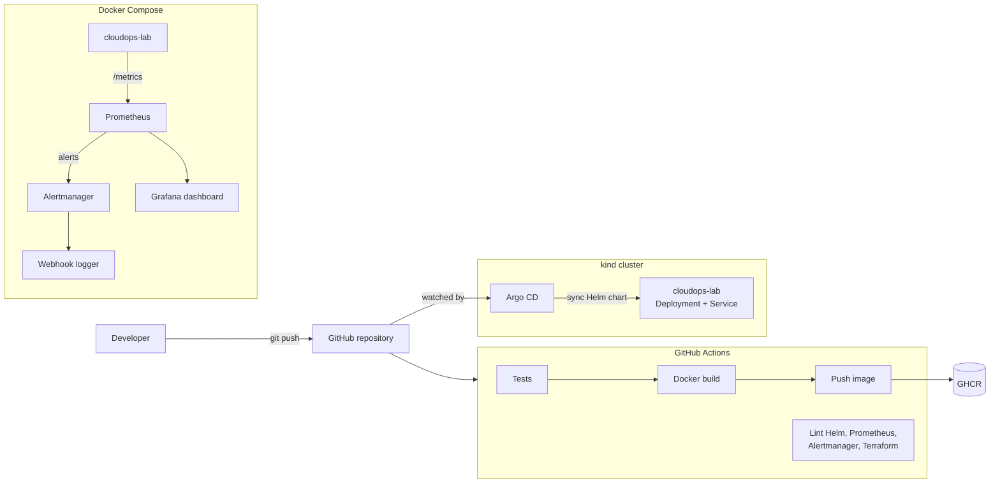

# CloudOps Lab

A small hands-on lab that takes one FastAPI service through the whole delivery
path: container image, CI/CD, Kubernetes with Helm, GitOps with Argo CD,
monitoring and alerting, and Infrastructure as Code for Azure.

Everything runs locally with free, open-source tools.

## Architecture



## Repository layout

| Path | Purpose |
|---|---|
| `app.py`, `test_app.py` | FastAPI service with `/`, `/health`, `/metrics` and its tests |
| `Dockerfile` | Image build; the app runs as a non-root user |
| `docker-compose.yml` | App plus the monitoring stack |
| `monitoring/` | Prometheus config and alert rules, Alertmanager config, Grafana provisioning and dashboard |
| `helm/cloudops-lab/` | Helm chart: Deployment with probes, resource limits and a restricted security context, Service |
| `argocd/application.yaml` | Argo CD Application that deploys the chart from this repository |
| `terraform/` | Azure infrastructure: resource group, ACR, AKS, Log Analytics |
| `.github/workflows/ci-cd.yml` | CI/CD pipeline |

## Run the tests

```bash
python -m venv .venv
.venv/bin/pip install -r requirements-dev.txt
.venv/bin/pytest -v
```

## Run the app with monitoring

```bash
docker compose up -d --build
```

| Service | URL |
|---|---|
| Application | http://localhost:8000 |
| Prometheus | http://localhost:9090 |
| Alertmanager | http://localhost:9093 |
| Grafana | http://localhost:3000 (dashboard "CloudOps Lab") |

The Prometheus data source and the dashboard are provisioned from files in
`monitoring/grafana/`, so a fresh Grafana needs no manual setup.

On Docker Desktop with WSL, the containers can come back broken after Docker
or the machine restarts: the ones that mount a single file stay stopped, and
Grafana starts without its dashboard. Recreate them:

```bash
docker compose up -d --force-recreate
```

### Trigger an alert

Compose enables the `/test-error` endpoint, which always returns HTTP 500.
Send errors for about three minutes and watch the alert arrive:

```bash
while true; do curl -s -o /dev/null localhost:8000/test-error; sleep 0.5; done
docker compose logs -f alert-logger
```

`HighHttpErrorRate` fires when more than 5% of requests fail for 2 minutes.
Alertmanager forwards it to a small webhook receiver that prints it. In a real
environment the receiver would be Slack, Teams, e-mail or an on-call tool.

## Deploy to Kubernetes with GitOps

Requires `kind`, `kubectl` and `helm`.

```bash
kind create cluster --name cloudops
docker build -t cloudops-lab:local .
kind load docker-image cloudops-lab:local --name cloudops

kubectl create namespace argocd
kubectl apply -n argocd --server-side \
  -f https://raw.githubusercontent.com/argoproj/argo-cd/v3.5.5/manifests/install.yaml
kubectl apply -f argocd/application.yaml
```

Argo CD watches `helm/cloudops-lab` on the `main` branch and keeps the
`cloudops` namespace in sync with it:

- A change pushed to Git (for example `replicaCount` in `values.yaml`) is
  rolled out automatically.
- A manual change in the cluster is reverted (`selfHeal`).
- A resource removed from Git is removed from the cluster (`prune`).

```bash
kubectl -n argocd get application cloudops-lab
kubectl -n cloudops get pods
```

The chart uses the locally loaded image `cloudops-lab:local`. In a real setup
it would point at the image the pipeline publishes to a registry, and a
release would be a commit that changes the image tag.

## Infrastructure as Code (Azure)

`terraform/` describes how the same setup maps to Azure:

| Local lab | Azure resource |
|---|---|
| kind cluster | AKS (`azurerm_kubernetes_cluster`) |
| GHCR | ACR (`azurerm_container_registry`) |
| Prometheus and Grafana | Azure Monitor Container Insights with a Log Analytics workspace |

The configuration passes `terraform validate` in CI. **It has not been applied**:
the AKS worker nodes are billed, and this lab uses only free resources.

```bash
cd terraform
terraform init
terraform plan -var subscription_id=<your-subscription-id>
```

## CI/CD pipeline

On every push and pull request to `main`:

1. **test** runs the pytest suite.
2. **validate** lints the Helm chart and checks the Prometheus, Alertmanager
   and Terraform configuration.
3. **docker-build** builds the image.
4. **publish** (pushes to `main` only, after all three jobs above pass) pushes
   the image to GHCR tagged `latest` and with the commit SHA.

## Not covered

- Ingress and TLS; the app is reached with `kubectl port-forward`.
- Monitoring inside the cluster; Prometheus scrapes the Compose instance.
- Secrets management and remote Terraform state.
